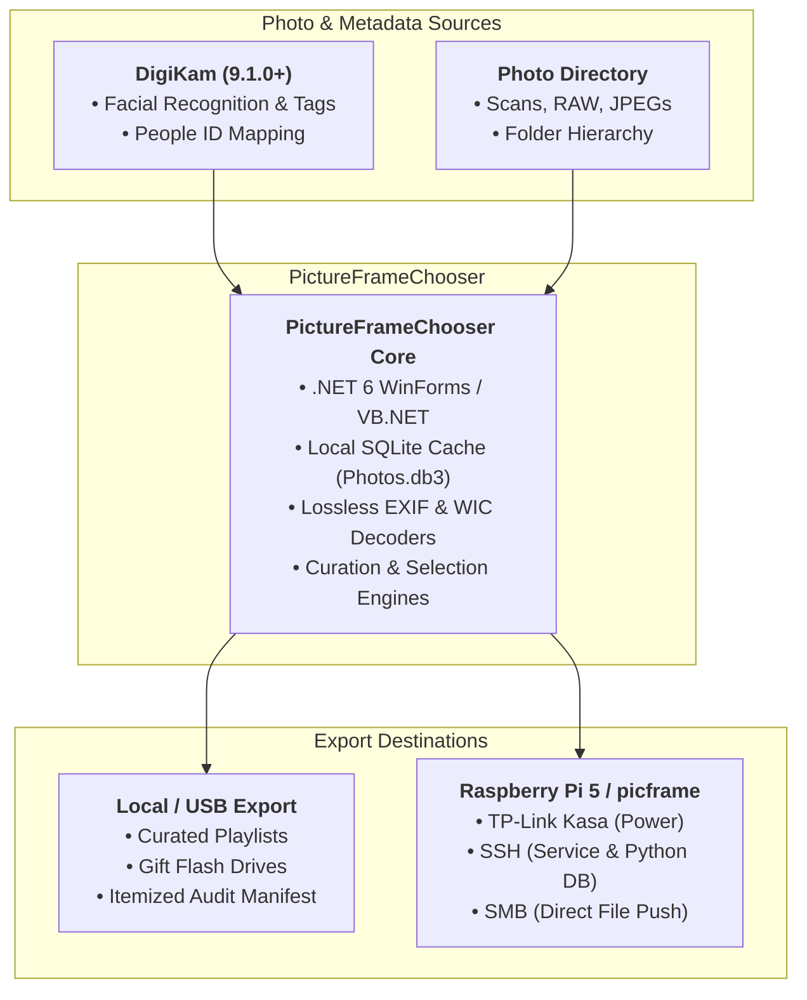

# PictureFrameChooser

**PictureFrameChooser** is an intelligent curation, metadata enhancement, and deployment engine designed for dedicated digital picture frames. 

It acts as the bridge between your primary photo management archive (**DigiKam**) and your living room display running **picframe / picframe3** (by helgeerbe) on a Raspberry Pi. 

Whether managing a 30-year library spanning digitized film prints, early compact digital cameras, and modern smartphone bursts, PictureFrameChooser ensures your living room screen displays curated, properly oriented, and context-aware slideshows without duplicate clutter or manual playlist fatigue.

---

## 🌟 Key Highlights

- **Lossless EXIF Repair**: Fixes rotated scans and legacy digital camera shots directly in file headers without re-encoding image pixels.
- **Triage & Cull (Single & Bulk)**: Weed out blurry shots, duplicates, and unflattering angles at hardware-accelerated speeds.
- **Global Person Exclusion**: Block an entire person (e.g., an ex-partner) across your entire archive with one click using DigiKam face tags.
- **Optical Date Assignment**: Dual-corner magnified loupe views specifically designed to inspect and transcribe burned-in camera date stamps on scanned photos.
- **Algorithmic Curation Engines**: Choose how your life story is told—via 3–4 photo event vignettes, multi-decade time-travel loops, seasonal orbits, or guest-prioritized party modes.
- **Intelligent Stream Deduplication**: Identifies identical photos across nested folders even if file names or EXIF tags differ, consolidating multiple disk copies into a single playlist entry.
- **Unattended Pi Automation**: Full end-to-end hardware pipeline that powers on a smart plug, pauses rendering, syncs over SMB, tracks remote SQLite indexing, and safely powers down.
- **Portable / Gift Exports**: Export curated sets to local directories or USB thumb drives to gift personalized slideshows to family and friends.

---

## 🛠️ Photo Review & Curation Tools

Older digital cameras and flatbed scanners lack internal gravity sensors, resulting in sideways or upside-down pictures and missing EXIF timestamps. Modern smartphones handle this automatically, but legacy photo archives require targeted curation tools:

### 1. Single Photo Review (1:1 Living Room Simulator)
* **True-to-Life Canvas**: Simulates the exact living room rendering engine of `picframe`, complete with matte borders, dynamic dominant mat color extraction, and lower-third gradient captions.
* **Lossless Orientation Patching**: Pressing `Left` or `Right` arrow keys immediately patches the EXIF Orientation tag (`0x0112`) directly in the physical JPEG header (or injects a minimal APP1 segment if missing). Your original pixel data is **never** decompressed or re-encoded.
* **Keyboard-Driven Workflow**: Single-stroke verification (`Space`), skip (`S` / `Down`), and instant block toggling (`B`).

### 2. High-Density Bulk Grid Review
* **Contact Sheet Curation**: Inspect hundreds of photos simultaneously across multi-column sheets powered by Windows Imaging Component (WIC) hardware sub-sampling.
* **Instant Culling**: Click or press `B` to flag blurry photos, test shots, bracketed bursts, or unflattering duplicates as **Blocked**. Blocked photos are immediately dimmed with a high-contrast badge and excluded from all future frame exports.
* **Instant Loupe (`Z` Key)**: Hold `Z` over any cell for an instant full-screen lightbox preview without losing your place in the grid.
* **One-Click Person Blocking**: Right-click any individual synced from DigiKam's facial recognition database to immediately block every photo containing that person across your entire collection.

### 3. Date Assignment Studio (For Film Scans & Legacy Media)
* **Dual-Corner Optical Loupe**: Automatically frames and magnifies the bottom-left and bottom-right corners of the image at up to 400% zoom, making burned-in orange/yellow film camera timestamps immediately legible.
* **Heuristic Path & Filename Parser**: Automatically extracts candidate dates from folder names, scanned film naming conventions (e.g., `10-14-06_Wedding`, `11-01-00_Chris`), smartphone compact timestamps, and holidays.
* **Rapid Continuous Keypad Entry**: Type dates directly without punctuation (e.g., typing `092385` instantly resolves to September 23, 1985) with decade and year jump controls.
* **Folder Batch Application**: Date an entire scanned roll or event folder in a single click with automated sequential second-spreading.

### 4. Clean-Room Ingestion & Deduplication
Over decades of backups, phone upgrades, and cloud imports, libraries accumulate duplicate files scattered across different folders, often with slightly altered file names or modified EXIF dates. PictureFrameChooser handles deduplication at the byte and image-stream level:
* **Metadata-Independent Hashing**: Instead of relying on fragile file names or whole-file hashes, the engine parses JPEG markers and hashes the compressed image scan payload (SOS) directly. Two identical photos with different file names or edited EXIF metadata tags are recognized as the exact same image.
* **DigiKam V3 Interoperability**: Concurrently computes DigiKam’s native 6-point sparse-sample MD5 hash (100 KB head + 5 $\times$ 25 KB chunks) to seamlessly cross-reference and map face tags from `digikam4.db`.
* **Multi-Path Consolidation**: When identical images are found across multiple folders, PictureFrameChooser links all physical locations to a single `PhotoFile` record rather than bloating your database with redundant entries.
* **Zero-Repetition Playlists**: Curation algorithms only ever evaluate the master photo once, guaranteeing that duplicate copies on disk never take up multiple slots on your living room display.

---

## ⚡ Built for Speed & Hardware Awareness

Managing tens of thousands of high-resolution camera files often leads to sluggish UI freezes and disk thrashing. PictureFrameChooser was engineered from the ground up for maximum throughput:

### 1. Adaptive Storage & Thread Profiling
Rather than using a fixed thread pool, the engine queries Windows kernel storage properties via `DeviceIoControl` (`IOCTL_STORAGE_QUERY_PROPERTY`) to inspect the underlying bus and seek penalties of your drive before scanning:
* **NVMe SSDs**: Scales up to utilize all available CPU cores in parallel.
* **SATA SSDs**: Clamped to balanced concurrency (up to 12 threads) to prevent controller saturation.
* **Mechanical HDDs**: Throttled strictly to 2 threads to prevent physical head thrashing and seek latency.
* **Network Storage (NAS / SMB)**: Throttled to 4 threads to avoid overwhelming network socket queues and round-trip metadata handshakes.

> **Real-World Benchmark**:  
> On local workstation hardware (*20 CPU cores, PCI-e NVMe SSD*), the engine scans, computes dual MD5/SHA-1 hashes, and extracts EXIF metadata across **66,000 photos in ~70 seconds**.  
> *(Note: Network shares, spinning disks, or remote NAS stores are naturally bounded by network latency and seek times; the engine automatically scales thread concurrency back on those targets to maintain system responsiveness).*

### 2. High-Performance Thumbnail Rendering Pipeline
Browsing contact sheets of 24–45 megapixel photos usually chokes memory and triggers constant garbage collection pauses. PictureFrameChooser avoids this using a multi-tiered pipeline:
* **Native WIC 1/8th DCT Sub-sampling**: Uses the Windows Imaging Component (`System.Windows.Media.Imaging`) to decode images at native stream level directly into thumbnail dimensions. Full-size 40 MB camera RAW/JPEGs are never decoded into RAM just to display a grid cell.
* **Multi-Page Lookahead Buffer**: The grid engine pre-decodes adjacent pages ($Current - 1$ through $Current + 2$) across background worker threads. Turning pages feels instantaneous because the next screen is already in memory.
* **Double-Buffered Custom GDI+ Canvas**: The entire grid is painted on a double-buffered single surface with zero child control overhead. You can page through hundreds of photos per second without flicker, stutter, or white-box redraw lag.
* **Garbage Collection Tuning**: Utilizes .NET's `SustainedLowLatency` memory management mode during review sessions to suppress Large Object Heap (LOH) pauses while rapidly cycling through images.

---

## 🎛️ Curation & Selection Algorithms

A living room frame shouldn't just run a naive alphabetical loop or get stuck showing 200 photos from a single vacation for three consecutive days. PictureFrameChooser features mathematical curation models tailored to how you live:

### 🌿 Everyday Life Models
1. **Mini-Event Vignettes (Story Chapters)**:
   * Instead of shuffling isolated individual photos, the engine curates cohesive 3-to-4 photo mini-chapters from least-seen folders across all decades.
   * *Living Room Experience*: Enjoy a 10-minute coherent mini-story (e.g., 3 slides of a camping trip), then naturally transition to Christmas morning 2025 or a weekend hike without getting bogged down in one event.
2. **Era Time-Travel Waves (Multi-Decade Loops)**:
   * Divides your archive into 5 chronological eras (1990s Scans $\rightarrow$ 2000s Young Family $\rightarrow$ 2010s School/Trips $\rightarrow$ 2020s Recent).
   * Generates playlist waves that sample 2 photos per era sequentially, letting you watch your family grow up in miniature multi-decade cycles during a single meal or evening.
3. **Seasonal Orbit (Rolling Anniversaries)**:
   * Targets a rolling calendar window (Today $\pm$ 30 days) across all 30+ years in your library.
   * Naturally matches the mood outside your window (autumn foliage, Halloween, summer vacations, or spring birthdays across 1990–present) with zero manual tagging required.
4. **Global Balanced Spread**:
   * Enforces a strict ceiling of 1–2 photos per folder, sorted strictly by least-recently-seen. Guarantees that every forgotten corner of your archive gets an equal voice.

### 🎉 Party & Guest Priority Mode
Hosting guests or having family over? Enter the names of your **Visiting Guests** and **Close Friends/Family**:
* The engine applies an **8-tier relevance scoring matrix**:
  * **Tier 1**: Pure group shots of visitors and close friends together (no extra crowd).
  * **Tier 2**: Pure visitor-only groupings.
  * **Tier 3**: Large reunion photos containing all visiting guests.
  * **Tiers 4–6**: Subsets, pairs, and solo highlight portfolios of each visitor.
  * **Tiers 7–8**: Close family fillers and general library background.
* Guarantees that guests see themselves and shared memories throughout the party without monopolizing the entire screen with one person.

---

## 🚀 Deployment & Target Destinations

PictureFrameChooser supports two export paths:

### 1. Direct Automated Hardware Sync Raspberry Pi Zero 2W (Raspberry Pi 5 in development)
For dedicated living room frames, an unattended **9-stage deployment pipeline** manages the entire update cycle:
1. **Smart Plug Actuation**: Powers on a TP-Link Kasa smart plug running the Pi (offline local network protocol).
2. **Boot Detection & Render Freeze**: Polls SSH until the Pi boots, then immediately stops the `picframe` systemd service to free 100% CPU/GPU and release SQLite database locks.
3. **Playback Bookmark Preservation**: Reads the active playback position via native Python SQLite queries, ensuring that a refreshed playlist can resume right where it left off rather than restarting at slide #1.
4. **Clean SMB Transfer**: Purges old slides and streams zero-padded, collision-free files (`0001_photo.jpg`) over Samba.
5. **Database Indexing Verification**: Restarts the service and actively polls the Pi's remote SQLite database until all new photos are fully cataloged.
6. **Graceful OS Halt & Power Cut**: Dispatches `sudo shutdown -h now`, waits for filesystem buffers to flush, and switches off the smart plug outlet to preserve hardware longevity.

### 2. Local Folder / USB Drive Export
* Export curated, collision-free sets to any local directory or external drive.
* **Gift Slideshows**: Perfect for loading a dedicated USB drive for grandparents, creating a wedding anniversary photo reel, or setting up offline displays for friends.
* **Audit Manifests**: Every export writes an itemized `_Copy_Manifest.txt` documenting the criteria used, source file paths, dates taken, and playback sequence.

---

## 🏗️ Architecture & Ecosystem

### Technology Stack
* **Runtime**: .NET 6 (Windows Forms)
* **Metadata & Codecs**: `MetadataExtractor`, Windows Imaging Component (`System.Windows.Media.Imaging`)
* **Database**: `Microsoft.Data.Sqlite` (Local write-ahead cache with WAL mode support)
* **Networking & Hardware**: `SSH.NET` (Renci), pure local UDP/TCP TP-Link Kasa autokey protocol
* **Security**: Windows DPAPI (`ProtectedData`) credential vault with rolling expiration envelopes

---

## 📋 Prerequisites

* **Operating System**: Windows 10 / 11 (64-bit)
* **.NET Runtime**: [.NET 6.0 Desktop Runtime](https://dotnet.microsoft.com/download/dotnet/6.0)
* **Photo Manager (Optional but recommended)**: [DigiKam 9.x](https://www.digikam.org/) (for facial recognition and people tagging)
* **Target Frame Display (Optional)**: Raspberry Pi 4 or 5 running Raspberry Pi OS Lite (headless) with [helgeerbe/picframe](https://github.com/helgeerbe/picframe)

---

## 🤝 Contributing

Contributions, feedback, and feature suggestions are very welcome!
1. Fork the repository.
2. Create a feature branch (`git checkout -b feature/NewCurationModel`).
3. Commit your changes (`git commit -m 'Add new seasonal curation preset'`).
4. Push to the branch (`git push origin feature/NewCurationModel`).
5. Open a Pull Request.

---

## 📄 License
This project is licensed under the [GNU General Public License v3.0](LICENSE).
